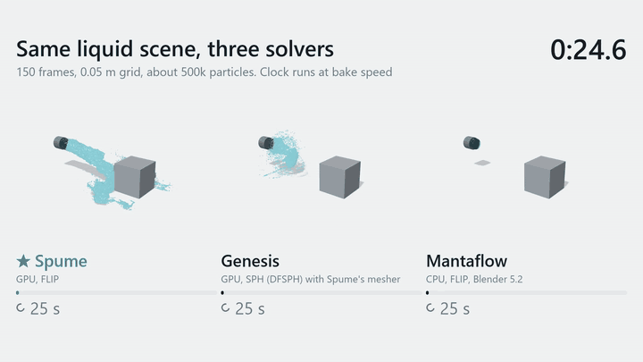

# Spume

A liquid solver for one consumer GPU. It bakes jets, geysers and torrents into a mesh sequence that you can load in Blender or three.js.



| Solver | Bake time | Device |
| --- | --- | --- |
| **Spume** | 2 min 10 s | GPU |
| Genesis (DFSPH) | 5 min 56 s | GPU |
| Mantaflow (Blender 5.2) | 73 min 44 s | CPU |

All three bake the same scene: 150 frames, a 0.05 m cell and about 500k particles, on one RTX 3060. Spume was tuned for this scene and the others are close to default. Mantaflow's inflow was set higher to match the 8 m/s jet, Genesis used Spume's mesher, and other jobs were running on the machine. Mantaflow still throws a better splash.

Spume uses FLIP on a staggered grid, Ihmsen whitewater (spray, foam and bubbles) and GPU marching cubes, written with [NVIDIA Warp](https://github.com/NVIDIA/warp). A [Blender add-on](blender/README.md) bakes from a Physics panel.

## Quick start

You need [uv](https://docs.astral.sh/uv/) and an NVIDIA GPU with a recent driver. uv gets Python 3.12 for you.

```bash
git clone https://github.com/codepawl/spume
cd spume
uv run spume --out out/test --cell 0.2 --width 6 --height 20 --frames 40 --mesh-cell 0.25
```

This small test takes seconds, plus a one-time kernel compile. The mesh of each frame goes to `out/test`, in the [output format](#output). To bake the full geyser, run this command:

```bash
uv run spume --out out/geyser --name geyser
```

To use the `spume` command outside the checkout, install it from the checkout:

```bash
uv tool install .
```

Without an NVIDIA GPU, add `--device cpu`. That works for a small test and is too slow for real work. The package is not on PyPI yet.

## Examples

A lateral torrent from a pipe (about 25 s at 0.15 m cells):

```
uv run spume --out out/outfall --inflow side --length 14 --width 6 --height 5 --cell 0.15 --opening 1.2 --speed 7 --feed 3 --frames 60 --mesh-cell 0.2 --preview out/outfall.png
```

A surge in a closed culvert:

```
uv run spume --out out/culvert --inflow side --closed --shape rectangle --opening-size 2.2 1.6 --length 14 --width 3 --height 3 --cell 0.15 --speed 6 --inflow-height 1.0 --frames 60 --mesh-cell 0.2 --preview out/culvert.png
```

A jet under a concrete slab, drained by a box at the far end (`--obstacle-box` and `--outflow-box` take `X0 Y0 Z0 X1 Y1 Z1` in domain metres):

```
uv run spume --out out/slab --width 8 --height 10 --cell 0.1 --inflow-position 3 4 --obstacle-box 2 4.3 3 4 5.5 5 --outflow-box 7.5 0 0 8 2 8 --frames 60
```

Two inflows from a file (`--inflows inflows.json`):

```json
[
  {"mode": "floor", "position": [3.0, 4.0], "speed": 17, "size": 0.7},
  {"mode": "side", "position": [0.0, 1.1, 3.8], "direction": [1, 0, 0], "speed": 7, "size": 1.1, "feed": 3}
]
```

## Command line

Units are metres, seconds, +Y up, the floor at y = 0 and the domain's low corner at the origin. Every option has a default (`--help`).

| Group | Options |
| --- | --- |
| Output | `--out` folder, `--name`, `--fps`, `--frames`, `--skip-seconds` (simulate without writing, to start on a steady flow), `--preview out.png` (point-cloud picture at three moments), `--seed` |
| Domain | `--cell` simulation cell, `--width` (z), `--length` (x, default = width), `--height`, `--closed` (solid walls on all six faces, ceiling included) |
| Inflow | `--inflow floor\|side`, `--inflow-position X Z` (floor) or `X Y Z` (side), `--inflow-height`, `--direction X Y Z`, `--shape circle\|rectangle`, `--opening` (diameter), `--opening-size WIDE HIGH`, `--speed`, `--rise`, `--feed`, `--taper`, `--cone`, `--turbulence` |
| Many inflows | `--inflows file.json`: a list of `{mode, position, direction, shape, size, speed, rise, feed, taper, delay}`. Missing keys take the command line values. `size` is a diameter, or `[wide, high]` for a rectangle. `delay` is the seconds before the pulse starts. |
| Obstacles | `--obstacle-mask file.npy` (bool array `(nx, ny, nz)` of solid cells on the solver grid, `nx = round(length / cell)`), `--obstacle-box X0 Y0 Z0 X1 Y1 Z1` (repeatable; every cell the box overlaps is solid) |
| Outflow | `--outflow-box X0 Y0 Z0 X1 Y1 Z1` (repeatable): liquid and whitewater inside are deleted |
| Pressure | `--pressure cg\|sor`, `--iterations`, `--omega` (SOR only) |
| Viscosity | `--viscosity` (m^2/s), `--viscosity-iterations` |
| Floor | `--floor-friction` (per second): slows liquid in the cell row on the floor. A slip floor makes a fast sheet thinner than a cell. Try 1 to 3, higher keeps the water deep |
| Liquid | `--liquid-box X0 Y0 Z0 X1 Y1 Z1` (repeatable; liquid at rest in the box at frame 0, solid cells skipped), `--particles-per-cell`, `--flip` (FLIP share of the PIC/FLIP blend), `--separation` (pushes crowded cells apart, so an impact splashes), `--cfl`, `--max-particles` |
| Surface | `--mesh-cell`, `--mesh-radius`, `--iso` |
| Whitewater | `--no-whitewater`, `--ww-capacity`, `--ww-trapped-rate`, `--ww-crest-rate`, `--ww-life MIN MAX`, `--ww-export` (points kept per frame), `--ww-buoyancy`, `--ww-drag` |

How the pieces behave:

- **Inflow.** A floor inflow is a vertical jet out of the floor at `--inflow-position` (default the middle). A side inflow is an opening at any point. When its centre lies on a domain face, that face is solid around it (a pipe wall). Every inflow has its own pulse: an optional delay, a smooth rise, a held feed, a smooth taper. An inflow at zero speed does not touch the flow.
- **Obstacles.** Solid cells carry no flow through their faces and no pressure. Liquid and whitewater particles slide along them. The mesher moves surface vertices out of a solid, so the mesh does not enter the obstacle.
- **Jet breakup.** `--turbulence` puts slow waves across the opening, in the speed and the direction of the water. They change at a Strouhal number of about 0.3 (speed over diameter). The solver has no surface tension or air. With `--turbulence 0`, a jet stays a smooth rod until it hits something.
- **Surface.** Each particle's kernel takes its shape from its neighbours (after Yu and Turk 2013). The kernel flattens on a sheet and stretches along a rope. Its centre moves towards the mean of its neighbours. A small blur on the density field joins the rest. Droplets with few neighbours go in after the blur, so they stay. The mesher mirrors particles near the floor, so a thin sheet keeps its full kernel. Triangles wind outward, so a renderer with backface culling still shows open sheets.
- **Walls.** The floor is always solid. `--closed` makes all six faces solid. Every other face is open air (pressure 0), and particles that leave through it are removed.
  Whitewater bounces off solid side walls and the ceiling.
- **Progress.** The solver prints `frame i/n` after every frame, so a host can show a progress bar.
- **Determinism.** Seeds are fixed, and a hash of each particle's id chooses the whitewater subsample. Particle-to-grid uses GPU atomics, and their order is not fixed. So two GPU runs agree closely, not bit for bit.

## Pressure solver

`--pressure cg` (default) is a matrix-free conjugate gradient with a Jacobi preconditioner, all on the GPU (`pressure.py`). The step lengths stay on the device, so an iteration never waits for the host. `--pressure sor` is the red-black SOR sweep. Use `--iterations 60` with it to get an asset from 0.1 or 0.2 again. Both start from the previous step's pressure. `--iterations` counts CG iterations or SOR sweeps (two half-sweeps each).

Measured on the street-geyser settings (RTX 3060, 180 frames, 213 thousand liquid particles, grid 113 x 250 x 113 at 8 cm). Residual is the worst divergence left in a liquid cell after projection, in 1/s. The table gives its mean over the frames and its worst frame. `sim` is the solver time without whitewater and mesh:

| Solver | Iterations | sim | mean residual | worst residual |
| --- | --- | --- | --- | --- |
| SOR | 60 | 48.4 s | 0.297 | 1.02 |
| CG | 20 | 42.9 s | 0.052 | 0.22 |
| CG | 40 | 51.3 s | 0.027 | 4.19 |
| CG | 60 | 61.7 s | 0.0005 | 0.07 |

CG with 20 iterations is faster and about six times tighter than SOR with 60. The 40 and 60 rows were timed while another program was using the GPU, so read their times as upper bounds.

A spike in the worst residual comes from a lone particle in a cell with a face that holds almost no weight. The particle does not read that face, so the spike does not move the liquid.

## Viscosity

`--viscosity` adds an implicit solve on the liquid faces after gravity and before pressure, by Jacobi sweeps (`diffuse_face` in `flip.py`). Solids and solid walls are no-slip. A free surface has no shear. Use a low `--flip` with it, such as 0.3, because FLIP noise breaks up a thick rope. The value is a kinematic viscosity: about 0.01 m^2/s for honey and 0.1 for thick cream, as a starting point. Few sweeps under-solve a high value, so the liquid is thinner than the number says.

## How thin or thick the liquid looks

These options set the look, from thin to thick:

| Option | Thinner | Thicker |
| --- | --- | --- |
| `--floor-friction` | 0 to 2: the liquid runs out in a sheet that tears | 8 or more: the liquid stays deep on the floor |
| `--separation` | 1.5: an impact throws water up | 0: an impact loses most of its energy, and the water stays low |
| `--turbulence` | 0.15 to 0.3 on a big jet: the jet tears and spreads | 0: the jet stays a smooth rod |
| `--flip` | 0.97 to 0.99: more splash, more loose droplets | 0.3 to 0.9: slow, smooth motion |
| `--iso` | 0.35 to 0.5: a thin surface | 0.2: a fat surface |
| `--viscosity` | 0 | 0.01 for honey, 0.1 for thick cream |

On a thin faucet stream, keep `--turbulence` low, about 0.06. A high value twists the stream. `--separation` also adds to the residual divergence in `report.json`, because it asks for divergence on purpose in crowded cells.

## How it stays fast

- `launcher.py` records each kernel launch and resends only the scalars that changed. On an RTX 3060, a plain `wp.launch` costs about 130 microseconds and a recorded one about 20. A step makes more than 100 launches.
- `sparse.py` runs the grid kernels only over active blocks of 8 x 8 x 8 cells. A block is active when it or a neighbour holds liquid. The pressure solve runs on a list of the liquid cells. Fields stay dense, so sampling still works anywhere.
- A step extrapolates velocity once, for whitewater. Liquid particles only read faces they splatted to.
- The step size comes from the fastest inflow or a free fall from the top of the domain. A small scene takes no extra steps.

The scene at the top of this page uses a 0.025 m mesh and no whitewater. It took 130 s on an RTX 3060 that another job was also using (simulation 31 s, mesh 83 s).

## Output

```
<out>/frame_0000.glb ...   one mesh per frame (binary glTF; positions int16 over the accessor min/max, normals int8)
<out>/spray.bin            float16 x y z vx vy vz per whitewater point, frames back to back
<out>/spray_ids.bin        uint32 per point, stable for the point's life (size and jitter per point in a renderer)
<out>/spray_kinds.bin      uint8 per point: 0 spray, 1 foam, 2 bubble (absent in caches from 0.1; treat as optional)
<out>/meta.json            fps, frame count, bounds, head height per frame, [first point, count] per frame in spray.index, settings, origin
<out>/report.json          time of each phase, video memory peak, residual divergence, byte count
```

Positions are relative to `meta.origin`, the first opening's centre on the floor (x and z). A scene can place the asset at the opening. Add `origin` back to get domain coordinates. With `--no-whitewater` the spray files are empty. `meta.settings.resolved_inflows` lists every inflow as it was used.

## Files

In `spume/`:

- `cli.py` the command line and the simulation loop.
- `flip.py` particles to grid, gravity, inflow openings, solid walls and obstacles, SOR pressure, grid to particles (PIC/FLIP blend), outflow boxes.
- `pressure.py` the conjugate-gradient pressure solve.
- `sparse.py` the active blocks and liquid cells. `launcher.py` recorded kernel launches.
- `whitewater.py` spray, foam and bubbles from trapped-air, wave-crest and kinetic-energy potentials (Ihmsen, Akinci, Becker and Teschner, "Unified spray, foam and air bubbles for particle-based fluids", 2012): emission, advection, per-point kind.
- `surface.py` anisotropic particle kernels to a density field, marching cubes, field-gradient normals.
- `export.py` the frame sequence writer. `preview.py` the point-cloud PNG.

`run.py` in the root only starts `spume` for older bake scripts. `blender/` holds the add-on.

## Tests

The tests run one small bake on the CPU, so they need no GPU:

```bash
uv run pytest
```

## Known faults

- `--separation` swells a still pool. One pool reached 0.54 m where the pumped volume gives about 0.46 m. It spilled late in the bake.
- Water on the floor ends in crumbs at its edges, not in sheets.
- The mesh takes most of the bake time, 83 s of 130 s in the scene above.
- The Blender add-on has no fields for `--separation`, `--floor-friction`, `--turbulence` or `--flip`.

## Not done yet

Surface tension, a multigrid preconditioner, moving obstacles.

## Licence

Apache-2.0, see [LICENSE](LICENSE). Copyright 2026 CodePawl. The code is original. It follows the published methods named above and uses Warp's public API.
