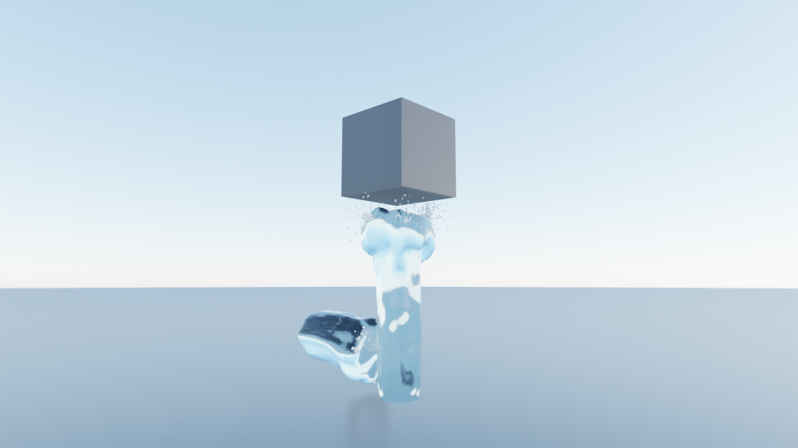
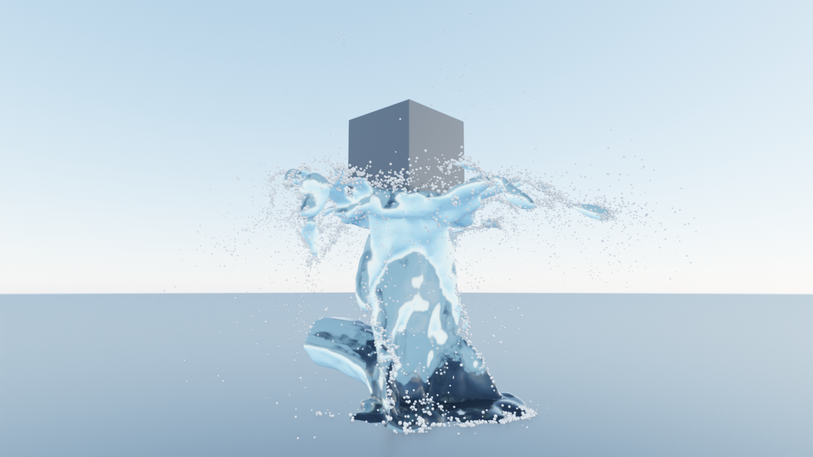
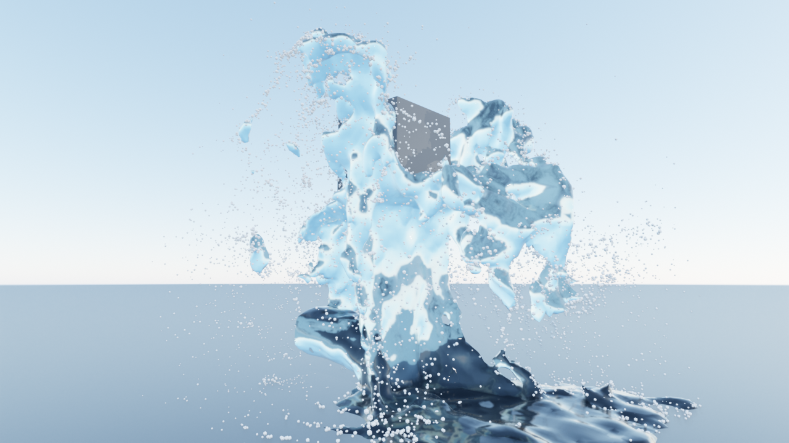

# Spume for Blender



`spume_addon/` is a Blender 4.2+ extension (tested on 5.2) that bakes the [Spume](../README.md) GPU liquid solver from a Physics panel and
plays the result back as a mesh sequence. Inflows, obstacles and outflows are ordinary Blender objects. Licence Apache-2.0, like the solver.

| Impact | Spread | Fall |
| --- | --- | --- |
|  |  |  |

Made by `test_addon.py`: a 17 m/s jet and a lateral torrent, with a 1.8 m cube held above the jet. Eevee, no post work.

## Install

Needs an NVIDIA GPU, [uv](https://docs.astral.sh/uv/) (or your own Python with `warp-lang`, `numpy`, `psutil`, `pillow`) and Blender 4.2 or newer.
From a checkout, build and install the extension with Blender's own command line:

```
blender --command extension build --source-dir blender/spume_addon --output-dir out
blender --command extension install-file --repo user_default --enable out/spume-0.3.0.zip
```

Or use Edit > Preferences > Add-ons > Install from Disk with that zip. In the add-on preferences set **Solver Folder** to the Spume checkout
(filled in automatically when the add-on runs from the checkout). A bake runs `uv run --project <checkout> spume ...` in a separate process,
at below-normal priority; set **Python** instead to use your own interpreter. Blender's own Python is never touched and Blender stays responsive.

## The panel

Select an object and open Properties > Physics > Spume. **Type** says what the object is to the solver:

| Type | What it does |
| --- | --- |
| Domain | The bounding box is the simulation grid. Its X is the solver length, Y the width, Z the height, and the lowest face is the floor. Rotation is kept, scale folds into the size. |
| Inflow | An opening that pushes liquid in, at the object's real position and direction. Any number of them. |
| Obstacle | A solid. The mesh is voxelized into the solver's solid cells (a closed mesh is needed; cells the mesh touches are solid, so voxels stick out up to one cell). |
| Outflow | A drain. The object's bounding box deletes the liquid and whitewater that enter it. |

**Inflow** settings: speed (m/s), direction (world space), shape (circle diameter, or rectangle width and height), and the pressure pulse in
seconds: rise, hold, taper. Pointing the inflow up from the floor makes a floor jet at the object's X and Y; any other placement is a lateral
opening at the object's position, and if it sits on a domain wall that wall is solid around the opening, like a pipe mouth.

**Domain** settings: cell size and mesh cell size (metres), frames, start frame, whitewater on/off and amount, the cache folder
(`//spume_cache/` is next to the .blend file), and the preview scale and frames.

- **Bake** runs the full settings, **Bake Preview** multiplies both cell sizes by the preview scale (2.5) and caps the frames (40).
- The progress bar and "Frame i of n" come from the `frame i/n` lines the solver prints; **Cancel** stops the whole process tree.
- **Load Cache** reloads the last bake, **Free** deletes the cache and the result objects.

## Result

`<Domain> Liquid` is a mesh that updates on every frame change (scrubbing works) with the *Spume Water* material.
`<Domain> Whitewater` is a point cloud with `radius`, `kind` (0 spray, 1 foam, 2 bubble, read from the solver) and `velocity` point attributes,
drawn as small spheres by the *Spume Whitewater Spheres* Geometry Nodes group and the *Spume Whitewater* material. Both objects take the
domain's transform at bake time. Caches from solver 0.1 have no kinds; the add-on then guesses them from speed.

The cache folder holds the solver's [output format](../README.md#output). The addon also leaves `inflows.json` and `obstacle.npy` there: the
exact input of the bake, which you can feed to `spume` by hand.

## Test

```
blender -b -t 6 --python blender/test_addon.py -- <cache folder> <previews folder>
```

It builds the scene above, bakes a preview with the real solver and checks that: no liquid vertex lies inside the cube, the jet reaches the
cube's underside and nothing climbs past its top, the second inflow is read from its real position, whitewater kinds come from the solver,
progress comes from the `frame i/n` lines. Then it renders the three stills into the previews folder. If PyPI is unreachable, set `UV_OFFLINE=1`.
